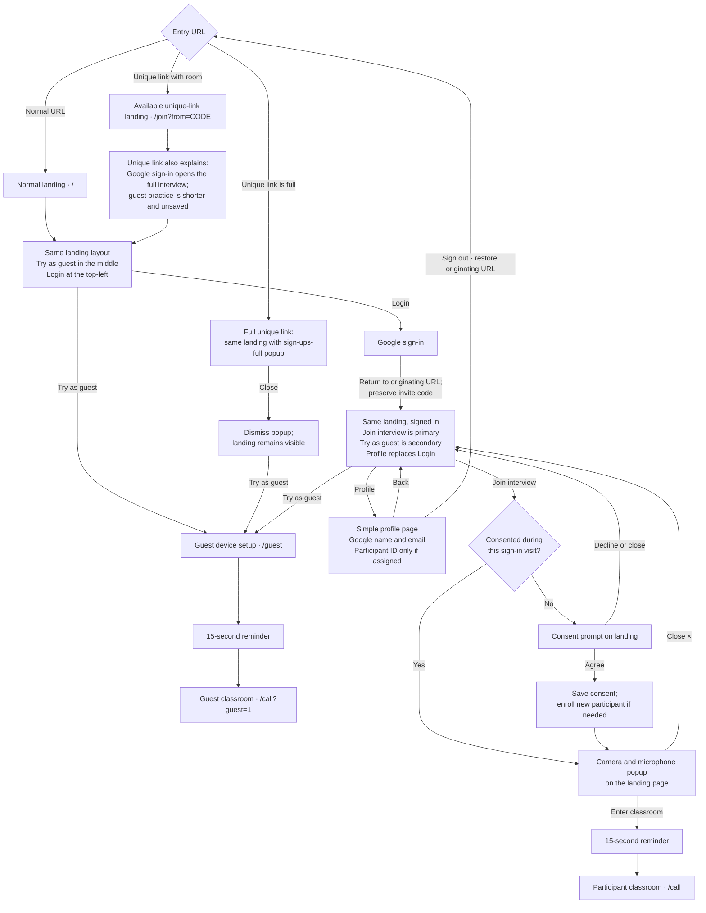

# Participant entry flow

Status: **implemented**. Use this diagram when changing landing pages, Google sign-in, profile, consent, and classroom entry. Full unique links currently retain the existing rule that blocks new Google sign-in.

## Rules to preserve during implementation

- Google sign-in returns to the landing URL that started it. The profile page never opens automatically.
- The normal and available unique-link landing pages share their layout. The unique link keeps its invite code and explains the difference between full and guest practice.
- Signed-in users can still choose guest practice without signing out. Guest sessions remain separate from participant study sessions.
- Consent appears after **Join interview** and before participant enrollment, device setup, or the classroom. Declining leaves the user on the signed-in landing page. Consent already given during this sign-in visit is not requested again.
- Closing the device popup keeps the user on the signed-in landing page. Signing out returns to the original landing URL with **Try as guest** and **Login** visible.
- A full unique link opens the landing page with a sign-ups-full popup over it. Closing the popup leaves the landing page visible. New participant sign-up is unavailable when the link is full.

## Module boundaries

- Both `/` and `/join?from=CODE` resolve a **landing view** on the server and pass it to the same landing module. The view provides signed-in state and consent status; the unique route also passes its link status:
  - **Signed out:** the originating URL is known; show **Try as guest** and **Login**. An available unique link adds its invitation explanation.
  - **Signed in:** include consent status for this visit and originating URL. Show **Join interview**, secondary **Try as guest**, and **Profile** when the link is available. The profile page loads Google account details and optional participant ID separately.
  - **Unique link full for this visitor:** show the shared landing with the sign-ups-full popup and guest option; do not offer **Join interview**. The account may be absent or present. An unknown link is handled by the route before producing a landing view.
- The landing module receives the server view and link status. It does not look up invite capacity, decide Google eligibility, or assemble OAuth return URLs.
- Google sign-in accepts only a validated landing destination: `/` or `/join?from=CODE`. The callback returns to that destination after checking the session. Failed sign-in returns there with an error. Profile is a separate page opened only by **Profile**; Sign out returns to the saved landing destination.
- The **Join interview** action owns the sequence. It shows consent if this visit has not yet consented; declining leaves the signed-in landing visible. A successful consent submission may enroll a new participant atomically, then opens device setup. If this visit already consented, it opens device setup directly. Device setup can close back to the landing or continue to the existing 15-second reminder and classroom.
- The consent submission returns either **ready** or an actionable failure such as **link full**, **sign-in lost**, or **temporarily unavailable**. Only **ready** opens device setup. If a link fills between page load and consent, the consent prompt displays the full-link message.

## Full-link policy

A full link shows the popup over the shared landing. After closing it, guest practice remains available. **Login** and **Join interview** are hidden on a full link, preserving the existing full-link restriction. A returning participant can still use an available link or the normal landing if their email is allowlisted. Allowing returning participants to log in through a full link remains a product decision.

## Profile design reference

The read-only account card follows the hierarchy in [Penpot's account profile reference](https://help.penpot.app/user-guide/account-teams/your-account/): recognizable identity at the top, account details below, and a separate action area. It uses NihonGo's existing color and spacing. A Mobbin connector was not available in this workspace.
